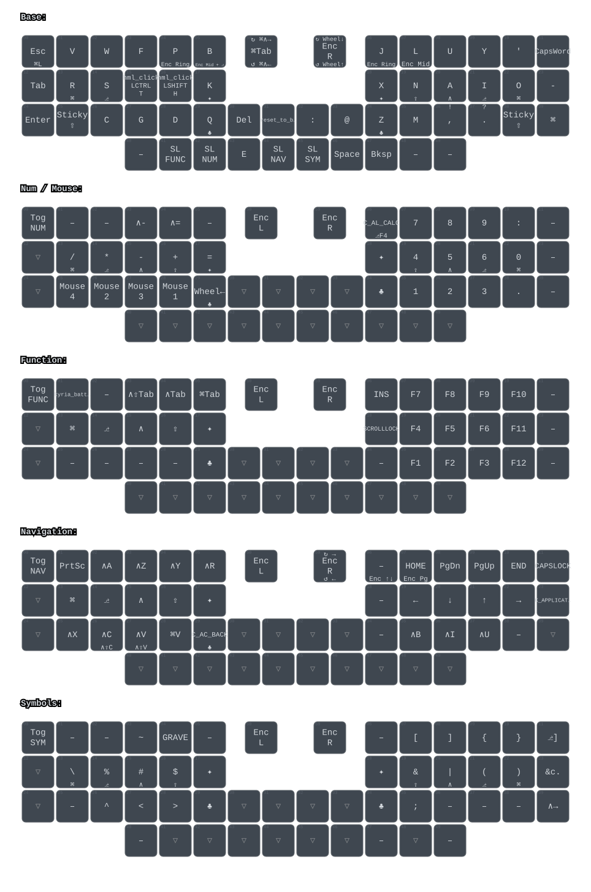

# Halcyon Kyria layout

* My own personal layout for my Halcyon Kyria (dual encoders)
* Layout originated as a duplicate of my old Voyager layout on [Oryx](https://configure.zsa.io/voyager/layouts/OwgPr/latest/0)
* Visualize the layout [here](https://customkeymap.com/?load=https%3A%2F%2Fraw.githubusercontent.com%2Fsmcateer%2Fzmk-halcyon-config%2Fmain%2Fconfig%2Fhalcyon_kyria.keymap&view=single&layer=0)
* Generated from splitkb/zmk-halcyon-config

# Layout

