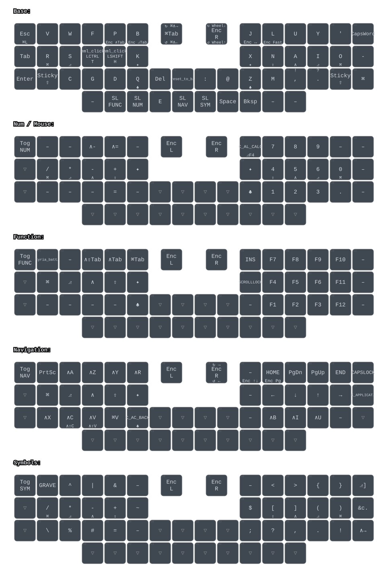

# Halcyon Kyria

My ZMK config for a wireless Halcyon Kyria with two encoders and a central dongle. The layout started as a copy of [my Voyager layout](https://configure.zsa.io/voyager/layouts/OwgPr/latest/0), with APTMAK on base. The firmware is based on [splitkb’s Halcyon config](https://github.com/splitkb/zmk-halcyon-config).

## Key addresses

I name keys by half, row and position. The first letter is the half (`L` or `R`). The second is the row (`T` for top, `M` for middle, `B` for bottom, `U` for upper thumb and `L` for lower thumb). Count inwards from the outside edge of each half, starting at `0`.

So `RT0` is the outermost key on the right top row and `RT5` is the innermost. `LL3` is the fourth key in from the outside on the left lower thumb row. These are physical positions and don’t change with the layer.

## Layout

[ZMK keymap](./config/halcyon_kyria.keymap) · [Interactive view of `main`](https://customkeymap.com/?load=https%3A%2F%2Fraw.githubusercontent.com%2Fsmcateer%2Fzmk-halcyon-config%2Fmain%2Fconfig%2Fhalcyon_kyria.keymap&view=single&layer=0)

I spend a fair bit of time with my left hand on the keyboard and my right on the trackball. Cut, copy, paste, undo and redo are all on the left side of NAV. I can select something with the trackball and do something with it without shifting either hand.

I use Vim and generally prefer sequences to chords. I tap the NAV thumb key, tap Copy, and I’m back on base. If I want to do several things on NAV, I hold the same thumb key. Symbols and Number work the same way. The thumb bindings are transparent on the other layers, so things like Space and Backspace stay where I expect them.

Symbols are roughly **mathsy on the left, typingish on the right**. The Number layer has digits on the right and arithmetic on the left. `/`, `*`, `-` and `+` are in the same places on both layers. I want to reach for `+` in the same place whether I’m typing code or entering a calculation.

## Encoders

Each dial responds to the keys next to it. A hold on the other side leaves the dial's action alone. The tables show clockwise / anticlockwise, with `--` meaning no adjacent key held. The layer is where the hold starts.

### Left encoder

| Layer / encoder | `--` | Hold `LT5` | Hold `LT4` |
| --- | --- | --- | --- |
| Base / left | Next / previous workspace | Alt+Tab / Alt+Shift+Tab | Ctrl+Tab / Ctrl+Shift+Tab |
| NAV / left | No action | No action | No action |

### Right encoder

| Layer / encoder | `--` | Hold `RT5` | Hold `RT4` |
| --- | --- | --- | --- |
| Base / right | Scroll down / up | Scroll right / left | Fast scroll down / up |
| NAV / right | Right / Left | Down / Up | Page Down / Page Up |

On Base, all four keys still type their usual letters when tapped. `LT5` holds Alt, so letting go selects the window. On NAV, `RT4` taps Home and `RT5` has no tap action. Once selected, an encoder mode lasts until the key is released, even if one-shot NAV expires. Number, Function and Symbols have no default rotation actions.

## The build

Both halves run on coin cells, with the holders inside the plate stack. I used encoders in place of the displays, black anodised aluminium top plates, stainless-steel bottom plates and blank black LDSA caps. The upper thumb keys are convex so I can tell them apart from the lower row by feel.

To check the batteries, I hit `LT1` on Function and the dongle types this into whatever text field I’m in:

```text
LEFT   [###########-]  94%
RIGHT  [###########-]  95%
```

## Drawing the layout

The [render script](./scripts/render_kyria.py) turns the ZMK keymap into input for keymap-drawer. It includes the encoder push buttons and skips the eight unused firmware positions. The SVG is checked in alongside the keymap so the diagram can show what’s on the branch you’re looking at.


